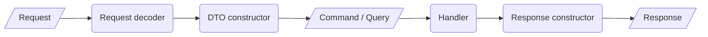

# CQS routing for Symfony

Build Symfony endpoints from small, typed building blocks instead of fat controllers. Each endpoint is just a **command or query**, a **handler** with the business logic and **one route definition**. Everything around it – decoding the request, constructing the DTO, validation, transactions and building the response – is done by reusable components that you configure once.

[](https://packagist.org/packages/digital-craftsman/cqs-routing)
[](https://packagist.org/packages/digital-craftsman/cqs-routing)
[](https://codecov.io/gh/digital-craftsman-de/cqs-routing)


## Why?

Symfony makes it very easy to build CRUD and REST endpoints. But the controller quickly becomes the place where everything happens: parsing the request, validating input, checking permissions, starting transactions, executing the business logic and building the response. It's fast to write, but expensive to change. In short, it's a **[low cost of introduction at the expense of the cost of change](https://www.youtube.com/watch?v=uQUxJObxTUs)**.

This bundle applies CQS (command query separation) to the HTTP layer and **drastically reduces the cost of change** with only slightly higher costs of introduction:

- **Business logic only in handlers.** Handlers never see the request. They receive a typed command or query and only contain domain logic.
- **No duplicated infrastructure code.** Request decoding, DTO construction, transactions, locking and response construction are written once as components and reused for every route.
- **Independent endpoints.** Every endpoint has its own command or query. Changing one endpoint can't accidentally break another one.
- **Type safe from request to response.** Commands and queries are value objects that validate themselves on construction. Static analysis tools like Psalm and PHPStan understand every step.
- **Safe refactoring.** Routes are defined in PHP with class references instead of strings in YAML, so renaming a class in your IDE updates the routing as well.
- **Fails early.** All routes are validated on cache warmup, so a misconfigured route is found before a request ever hits it – with no validation costs at runtime.

### Before and after

A classic controller mixes infrastructure and business logic:

```php
#[Route('/api/news/create-news-article', methods: ['POST'])]
public function createNewsArticle(Request $request): JsonResponse
{
    $data = json_decode($request->getContent(), true);
    if (!isset($data['title'], $data['content'])) {
        return new JsonResponse(['error' => 'Missing data'], 400);
    }

    $user = $this->userRepository->getOne($this->getUser()->getId());
    $user->mustHavePermissionToWriteArticle();

    $this->connection->beginTransaction();
    try {
        $this->entityManager->persist(new NewsArticle(/* ... */));
        $this->entityManager->flush();
        $this->connection->commit();
    } catch (\Throwable $exception) {
        $this->connection->rollBack();
        throw $exception;
    }

    return new JsonResponse(null, 204);
}
```

With CQS routing, the same endpoint is a route definition, a command and a handler. Decoding, DTO construction, the transaction and the response are handled by components that were configured once for all routes:

```php
RouteBuilder::addCommandRoute(
    $routes,
    path: '/api/news/create-news-article-command',
    dtoClass: CreateNewsArticleCommand::class,
    handlerClass: CreateNewsArticleCommandHandler::class,
);
```

```php
final readonly class CreateNewsArticleCommandHandler implements CommandHandler
{
    public function __invoke(CreateNewsArticleCommand $command): void
    {
        $user = $this->userRepository->getOne($command->userId);
        $user->mustHavePermissionToWriteArticle();

        $this->entityManager->persist(new NewsArticle(/* ... */));
        $this->entityManager->flush();
    }
}
```

## How it works

Every request runs through the same pipeline. The `CommandController` and the `QueryController` take care of it, you only define which components to use.



These are the components of the pipeline. Only the request decoder, the DTO constructor and the response constructor are required, and the bundle already ships with implementations for them.

| Component                                                         | Purpose                                                                        | Included implementations                                                                                                         |
|-------------------------------------------------------------------|--------------------------------------------------------------------------------|----------------------------------------------------------------------------------------------------------------------------------|
| [Request validator](./docs/examples/request-validator.md)         | Validates the request on an application level (e.g. headers, virus scan).      | –                                                                                                                                |
| [Request decoder](./docs/examples/request-decoder.md)             | Turns the request into request data as an array.                               | `JsonRequestDecoder`                                                                                                             |
| [Request data transformer](./docs/examples/request-data-transformer.md) | Casts, sanitizes or adds request data.                                   | –                                                                                                                                |
| [DTO constructor](./docs/examples/dto-constructor.md)             | Constructs the command or query from the request data.                         | `SerializerDTOConstructor`                                                                                                       |
| [DTO validator](./docs/examples/dto-validator.md)                 | Validates the command or query against application or infrastructure state.    | –                                                                                                                                |
| [Handler](./docs/examples/handler.md)                             | Contains the business logic. Only query handlers return a value.               | –                                                                                                                                |
| [Handler wrapper](./docs/examples/handler-wrapper.md)             | Runs logic before, after and on failure of a handler (e.g. transactions, locks). | `SilentExceptionWrapper`                                                                                                       |
| [Response constructor](./docs/examples/response-constructor.md)   | Turns the return value of the handler into a response.                         | `EmptyResponseConstructor`, `EmptyJsonResponseConstructor`, `SerializerJsonResponseConstructor`, `StreamedResponseConstructor` |

The full process including all optional components and when to use (and not to use) which component is [described here](./docs/process.md).

## Installation

Requires PHP 8.5 or 8.6 and Symfony 7.4 or 8.

```shell
composer require digital-craftsman/cqs-routing
```

### Configuration

Add a `config/packages/cqs-routing.php` file with the default components for all commands and queries:

```php
<?php

declare(strict_types=1);

use DigitalCraftsman\CQSRouting\DTOConstructor\SerializerDTOConstructor;
use DigitalCraftsman\CQSRouting\RequestDecoder\JsonRequestDecoder;
use DigitalCraftsman\CQSRouting\ResponseConstructor\EmptyJsonResponseConstructor;
use DigitalCraftsman\CQSRouting\ResponseConstructor\SerializerJsonResponseConstructor;
use Symfony\Component\DependencyInjection\Loader\Configurator\App;

return App::config([
    'cqs_routing' => [
        'query' => [
            'default_request_decoder_class' => JsonRequestDecoder::class,
            'default_dto_constructor_class' => SerializerDTOConstructor::class,
            'default_response_constructor_class' => SerializerJsonResponseConstructor::class,
        ],
        'command' => [
            'default_request_decoder_class' => JsonRequestDecoder::class,
            'default_dto_constructor_class' => SerializerDTOConstructor::class,
            'default_response_constructor_class' => EmptyJsonResponseConstructor::class,
        ],
    ],
]);
```

With this, you're ready to go. The [full configuration](./docs/configuration.md) (including an example in YAML) shows how to add default request validators, request data transformers, DTO validators and handler wrappers.

All components are registered automatically through autoconfiguration as soon as they implement the relevant interface.

## Usage

An endpoint consists of three parts: a command (or query), a handler and a route.

### 1. Create a command

Commands and queries are strongly typed value objects which validate whatever they can on construction. When the object exists, it's valid.

```php
<?php

declare(strict_types=1);

namespace App\Domain\News\WriteSide\CreateNewsArticle;

use App\Helper\HtmlHelper;
use App\ValueObject\UserId;
use Assert\Assertion;
use DigitalCraftsman\CQSRouting\Command\Command;

final readonly class CreateNewsArticleCommand implements Command
{
    public function __construct(
        public UserId $userId,
        public string $title,
        public string $content,
        public bool $isPublished,
    ) {
        Assertion::notBlank($this->title);
        Assertion::maxLength($this->title, 255);

        Assertion::notBlank($this->content);
        Assertion::maxLength($this->content, 1000);
        HtmlHelper::assertValidHtml($this->content);
    }
}
```

### 2. Create a handler

The structural validation is already done by the command, so the handler only contains the business logic. It's invoked with the command and never touches the request.

```php
<?php

declare(strict_types=1);

namespace App\Domain\News\WriteSide\CreateNewsArticle;

use App\Entity\NewsArticle;
use App\Repository\UserRepository;
use App\ValueObject\NewsArticleId;
use DigitalCraftsman\CQSRouting\Command\CommandHandler;
use Doctrine\ORM\EntityManagerInterface;
use Psr\Clock\ClockInterface;

final readonly class CreateNewsArticleCommandHandler implements CommandHandler
{
    public function __construct(
        private ClockInterface $clock,
        private UserRepository $userRepository,
        private EntityManagerInterface $entityManager,
    ) {
    }

    public function __invoke(CreateNewsArticleCommand $command): void
    {
        $commandExecutedAt = $this->clock->now();

        // Validate
        $requestingUser = $this->userRepository->getOne($command->userId);
        $requestingUser->mustNotBeLocked();
        $requestingUser->mustHavePermissionToWriteArticle();

        // Apply
        $newsArticle = new NewsArticle(
            NewsArticleId::generateRandom(),
            $command->title,
            $command->content,
            $command->isPublished,
            $commandExecutedAt,
        );

        $this->entityManager->persist($newsArticle);
        $this->entityManager->flush();
    }
}
```

Query handlers work the same way, but return a value (usually a read model), which is then turned into a response by the configured response constructor. See the [handler examples](./docs/examples/handler.md).

### 3. Add the route

Routes are defined in PHP through the `RouteBuilder`. You only need to define the components that differ from the defaults in your `cqs-routing.php`.

```php
<?php

declare(strict_types=1);

use DigitalCraftsman\CQSRouting\Routing\RouteBuilder;
use Symfony\Component\Routing\Loader\Configurator\RoutingConfigurator;

return static function (RoutingConfigurator $routes) {

    RouteBuilder::addCommandRoute(
        $routes,
        path: '/api/news/create-news-article-command',
        dtoClass: CreateNewsArticleCommand::class,
        handlerClass: CreateNewsArticleCommandHandler::class,
        dtoValidatorClasses: [
            UserIdValidator::class => null,
        ],
    );

    RouteBuilder::addQueryRoute(
        $routes,
        path: '/api/news/get-news-articles-query',
        dtoClass: GetNewsArticlesQuery::class,
        handlerClass: GetNewsArticlesQueryHandler::class,
    );

};
```

The `RouteBuilder` chooses the controller (`addCommandRoute` or `addQueryRoute`), uses `POST` as default method, generates the route name from the path and validates all parameters on cache warmup. Read more about [routing](./docs/routing.md), including how to extend or overwrite the defaults per route.

## Further documentation

- [Process and component usage](./docs/process.md) – what each component is for and what it must not be used for.
- [Routing](./docs/routing.md) – all route options and how defaults are merged or overwritten.
- [Configuration](./docs/configuration.md) – the full bundle configuration.
- Examples: [request validator](./docs/examples/request-validator.md), [request decoder](./docs/examples/request-decoder.md), [request data transformer](./docs/examples/request-data-transformer.md), [DTO constructor](./docs/examples/dto-constructor.md), [DTO validator](./docs/examples/dto-validator.md), [handler](./docs/examples/handler.md), [handler wrapper](./docs/examples/handler-wrapper.md), [response constructor](./docs/examples/response-constructor.md).
- [Changelog](./CHANGELOG.md) and [upgrade guide](./UPGRADE.md).

## Sponsors

[](https://blackfire.io)
